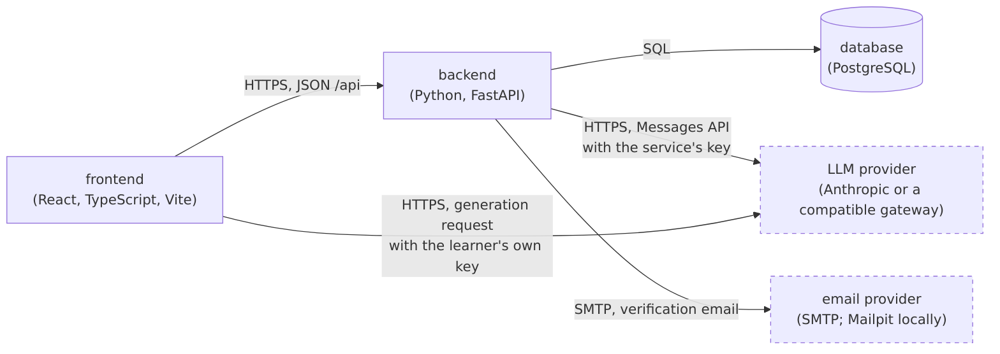

# Architecture

This document records what the Sentence Cards Generator is made of, and [the product vision](../product-vision.md) is the scope it serves.

## Drivers

- **Business goals:** [the threshold of success](../threshold-of-success.md) holds the goals the architecture serves.
- **Constraints:** the product vision's [constraints section](../product-vision.md#constraints) holds the conditions the architecture lives inside.
- **Functional requirements:** the [functional requirements index](../functional-requirements/README.md) holds the behavior the architecture must deliver.
- **Quality requirements:** the [quality requirements index](../quality-requirements/README.md) holds the quality the architecture must meet, and it is also the priority matrix.

## Container View

The product runs as the containers below, and [`ADR-001`](adr/ADR-001.md) decides that split and the stack it runs on.

### Container Responsibilities

| Container | Responsibilities |
| --- | --- |
| `frontend` | Renders the reader, the decks, study, Settings, and Teaching; keeps the learner's own LLM key and sends generation requests with it straight to the provider; keeps per-browser preferences such as reading aloud |
| `backend` | Owns the rules for accounts, texts, decks, cards, sharing, and study; builds each generation request and checks every sentence before saving it; schedules reviews; calls the LLM provider with the service's key and sends the verification email |
| `database` | Stores the accounts, profiles, texts and their marked words, decks, cards, reviews, and deck shares; keeps the schema at the latest migration |

## Diagrams And Legends

In the container view, solid boxes are the containers, the cylinder is a data store, and dashed boxes are external systems the product calls; each arrow is one exchange, labelled with what crosses it, and points from the caller.
The two arrows into the LLM provider are the two ways a sentence is written: with the service's key from the `backend`, or with the learner's own key from the `frontend`, per [`ADR-002`](adr/ADR-002.md).
The email provider is Mailpit, a local inbox, when the product runs on a laptop.
The image is [`container.png`](container.png), rendered with Mermaid CLI 11.4.2 from its source [`container.mmd`](container.mmd).
The system context diagram is in [the product vision](../product-vision.md#system-context).

## Architectural Decisions

| ADR | Status | Addresses | Decision |
| --- | --- | --- | --- |
| [ADR-001](adr/ADR-001.md) | Accepted | [FR-001](../functional-requirements/fr/FR-001.md), [FR-003](../functional-requirements/fr/FR-003.md), [FR-009](../functional-requirements/fr/FR-009.md), [FR-011](../functional-requirements/fr/FR-011.md), [QR-02](../quality-requirements/qr/QR-02.md), [QR-04](../quality-requirements/qr/QR-04.md) | One frontend, one backend, and a PostgreSQL database |
| [ADR-002](adr/ADR-002.md) | Accepted | [FR-003](../functional-requirements/fr/FR-003.md), [FR-005](../functional-requirements/fr/FR-005.md), [QR-01](../quality-requirements/qr/QR-01.md), [QR-05](../quality-requirements/qr/QR-05.md) | Keep the learner's own key in the browser |
| [ADR-003](adr/ADR-003.md) | Accepted | [FR-003](../functional-requirements/fr/FR-003.md), [FR-004](../functional-requirements/fr/FR-004.md), [QR-03](../quality-requirements/qr/QR-03.md), [QR-04](../quality-requirements/qr/QR-04.md), [QR-05](../quality-requirements/qr/QR-05.md) | Check each sentence and ask again with the reason, up to three attempts |
| [ADR-004](adr/ADR-004.md) | Accepted | [FR-011](../functional-requirements/fr/FR-011.md), [QR-01](../quality-requirements/qr/QR-01.md) | Share a deck through an explicit share record |
| [ADR-005](adr/ADR-005.md) | Accepted | [FR-008](../functional-requirements/fr/FR-008.md), [FR-009](../functional-requirements/fr/FR-009.md), [QR-02](../quality-requirements/qr/QR-02.md) | Schedule reviews with the FSRS library in the backend |

New records start from [the template](adr/TEMPLATE.md).
