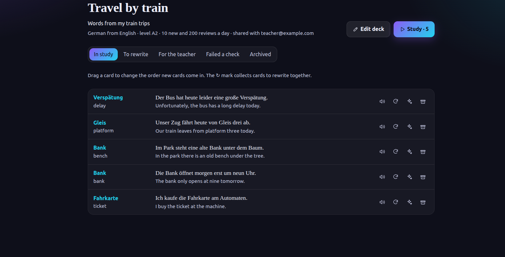

# Week 05 report

## Project

Sentence Cards Generator, Team 5.

## Summary

The testing work adds frontend client regression tests to the existing backend suite and prepares their integration into product CI in a separate workflow change.
The local checks, results, and environment limitations are recorded in [testing.md](testing.md).
The product is deployed to staging and production on the university VM, as described in [the deployment runbook](../../docs/deployment.md) and [the deployment below](#deployment); it is reached from the university network, at the address given in the Moodle submission.
Every active High business-importance quality requirement now has a test; their results, including the ones not yet verified, are in the [quality requirement testing plan](../../docs/project-plan.md#quality-requirement-testing-plan).
The product CI names a step for each applicable check; the backend build is recorded as not applicable, because the backend runs from source with no compile or bundle step.
After the [Sprint Review](meeting-report.md), the release commit `b904ab3` was redeployed and retested, and REL-05 was released as [v0.3.0](https://github.com/itpd-2026-team-5/team-5-sentence-card-generator/releases/tag/v0.3.0); its record is in the [plan](../../docs/project-plan.md#rel-05).
The team contribution evidence still needs to be completed for Submission 5.

## Coverage

| Deliverable | Artifact |
| --- | --- |
| Test suite and automated checks | [reports/week-05/testing.md](testing.md) |
| Feature documentation | [docs/features.md](../../docs/features.md) |
| Deployment runbook | [docs/deployment.md](../../docs/deployment.md) |
| Staging and production deployment | [Deployment](#deployment) |
| Sprint Review | [reports/week-05/meeting-report.md](meeting-report.md) |
| Quality requirement testing plan | [docs/project-plan.md](../../docs/project-plan.md#quality-requirement-testing-plan) |
| REL-05 | [docs/project-plan.md](../../docs/project-plan.md#rel-05) |
| Sprint retrospective | [reports/week-05/sprint-retrospective.md](sprint-retrospective.md) |
| AI usage | [reports/week-05/ai-usage.md](ai-usage.md) |

## Deployment

On 2026-10-31, `saleemasekrea000` deployed commit [`248b766`](https://github.com/itpd-2026-team-5/team-5-sentence-card-generator/commit/248b766bb91a9e5dd4f4f73118c0506e0b84fd89) by hand from a campus machine, following [the deployment runbook](../../docs/deployment.md): first to staging, then the same checkout to production, on the university VM at `<university-vm-ipv4>`.

- Staging, port 8081: `curl http://localhost:8081/api/health` on the VM returned `{"status":"ok"}`, after the backend had run every database migration.
- Production, port 8080: `curl http://localhost:8080/api/health` returned `{"status":"ok"}`.
- Production was loaded with the demo data (`python -m app.seed`), and from a campus browser the demo learner signed in and opened the "Travel by train" deck and its cards:



What the production check verified of the [core task](../../docs/setup.md#complete-the-core-task): signing in, adding a text, marking words to learn, and reading a deck's cards.
What it did not verify: generating new cards, because the LLM providers cannot be reached from the university network; see [Deviations](#deviations) and the [failed deploy record](../../docs/deployment.md#2026-10-31-card-generation-cannot-reach-an-llm-from-the-vm).

### QR-07 QRT-01 on staging

The `deployed` check of [QR-07 QRT-01](../../docs/quality-requirements/qr/QR-07.md#qrt-01), run on 2026-10-31 by `saleemasekrea000` on the university VM.

- **Environment:** the staging deployment (`cards-staging`) with the demo data, reached at `$STAGING_URL`.
- **Commit:** [`130b5a3`](https://github.com/itpd-2026-team-5/team-5-sentence-card-generator/commit/130b5a3fcf32b38f025d7f0f3aeb8c9d4de78b03), deployed to staging before the run.
- **Command:** `scripts/check-restart.sh`, from `~/cards/app` on the VM.
- **Measured value:** 11 tables and 72 rows unchanged after each of three stop-and-start cycles and after the interrupted write; the next scheduled review unchanged; every index passes `amcheck`.

```text
commit: 130b5a3fcf32b38f025d7f0f3aeb8c9d4de78b03
target: cards-staging at $STAGING_URL
cycle 1: stop and start of backend and db (11 tables, 72 rows)
  records: same
  next scheduled review (card 1): same
cycle 2: stop and start of backend and db (11 tables, 72 rows)
  records: same
  next scheduled review (card 1): same
cycle 3: stop and start of backend and db (11 tables, 72 rows)
  records: same
  next scheduled review (card 1): same
interrupted write: database killed during an uncommitted update of every deck
  records: same
integrity: every btree index passes amcheck
PASS
```

### QR-07 QRT-01 on the release commit

After the Sprint Review, on 2026-10-31, `saleemasekrea000` redeployed `main` at [`b904ab3`](https://github.com/itpd-2026-team-5/team-5-sentence-card-generator/commit/b904ab3b668c52754f1050406c3d65dcdc17dce5), which adds the fix for texts without a language, to staging and then production, and reran the `deployed` check of [QR-07 QRT-01](../../docs/quality-requirements/qr/QR-07.md#qrt-01) on staging.

- **Environment:** the staging deployment (`cards-staging`) with the demo data, reached at `$STAGING_URL`; `curl http://localhost:8081/api/health` returned `{"status":"ok"}` before the run.
- **Commit:** `b904ab3`, the commit tagged `v0.3.0`.
- **Command:** `scripts/check-restart.sh`, from `~/cards/app` on the VM.
- **Measured value:** 11 tables and 72 rows unchanged after each of three stop-and-start cycles and after the interrupted write; the next scheduled review unchanged; every index passes `amcheck`.

```text
commit: b904ab3b668c52754f1050406c3d65dcdc17dce5
target: cards-staging at $STAGING_URL
cycle 1: stop and start of backend and db (11 tables, 72 rows)
  records: same
  next scheduled review (card 1): same
cycle 2: stop and start of backend and db (11 tables, 72 rows)
  records: same
  next scheduled review (card 1): same
cycle 3: stop and start of backend and db (11 tables, 72 rows)
  records: same
  next scheduled review (card 1): same
interrupted write: database killed during an uncommitted update of every deck
  records: same
integrity: every btree index passes amcheck
PASS
```

The same commit then went to production, after a backup of its database, and was checked from a campus browser: the demo learner signed in, opened a text, marked a word, and opened a deck.
Generating cards remains unverified there, as recorded in the deviations.

## Deviations

Backend tests required a temporary event-loop workaround in this execution environment, and local frontend lint could not run because its native dependency was missing.
See [the test results and limitations](testing.md#results); a green hosted run is still required.

On production, the last step of the core task, generating cards for the marked words, could not be verified.
The VM cannot reach the Claude API (the connection times out) and OpenRouter refuses it (`403`), and a learner's own key in the browser fails the same way from the campus network.
The deployment is otherwise working; generation needs an LLM gateway reachable from the university network, as the [runbook](../../docs/deployment.md#2026-10-31-card-generation-cannot-reach-an-llm-from-the-vm) describes.

[QR-03 QRT-01](../../docs/quality-requirements/qr/QR-03.md#qrt-01) is a `manual` test: whether a generated card can be kept is the reviewer's and the learner's judgement, which no command can assert.
Its run also needs the service's LLM, which the university VM cannot reach, as recorded above.

## Privacy

No private-only material was committed as part of this testing work.
