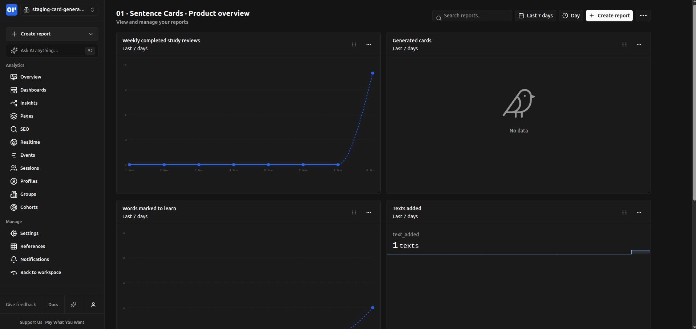
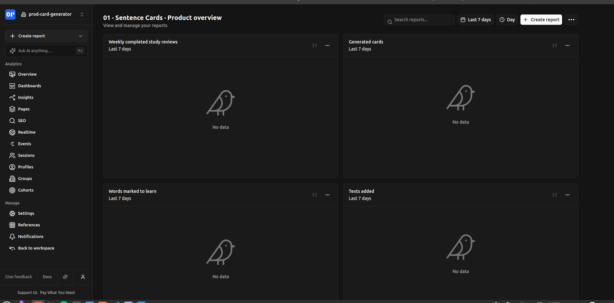
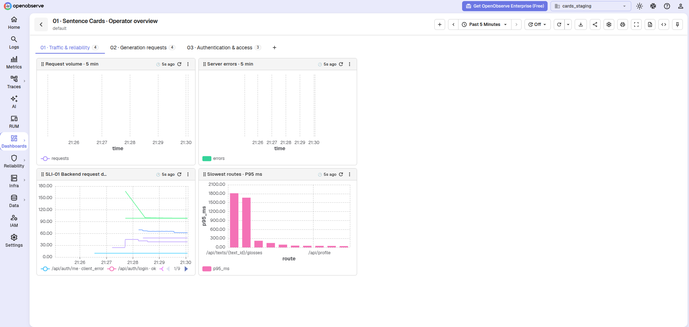
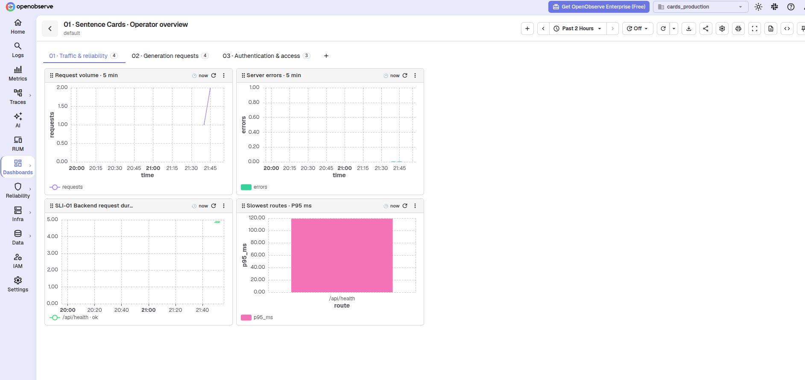

# Week 06 report — Sentence Card Generator, Team 5

The [OpenPanel evidence](openpanel-evidence.md) shows the staging smoke event, its exclusion filter, and the staging and production product dashboards.

The [OpenObserve dashboard evidence](openobserve-dashboard-evidence.md) records the staging and production SLI-01 panels, production request-log delivery, and a staging diagnostic failure series. The [late QR-10 core-task check](qr10-evidence.md) records the 2026-11-09 passing staging result, including a matching log within 0.861 seconds and numeric P95 within 9.175 seconds. This evidence was produced after the 2026-11-08 deadline and is included in the Week 6 late submission.

The [late Part 13 deployment record](part13-deployment-evidence.md) documents the same-commit staging and production redeployment, a passing staging QR-10 retry, and the still-unreachable Claude API during production generation. Production health and an existing deck worked; new card generation did not.

The [AI usage report](ai-usage.md) records the tools used for this week's work and how the output was reviewed.

## Summary

The [SPRINT-06 plan](../../docs/project-plan.md#sprint-06) delivered analytics and observability definitions, instrumented events and request signals, and staging and production dashboards. The [analytics plan](../../docs/analytics.md#weekly-completed-study-reviews) defines the focus metric as the count of saved study ratings over seven days, excluding `source=smoke`; the [observability plan](../../docs/observability.md#sli-01) defines the five-minute request-duration P95. The focus-metric query produces the **Weekly completed study reviews** chart: the [staging dashboard](images/openpanel-staging-overview.png) plots activity, while the [production dashboard](images/openpanel-production-overview.png) has no matching reviews in the captured range. The screenshots do not establish a verified numeric total or completion by outside learners; those need real study ratings and a queryable count for the chosen period.

The [testing plan](../../docs/project-plan.md#quality-requirement-testing-plan) records QR-10 as passing on 2026-11-09, after the sprint deadline, and gives the reasons QR-01, QR-03, and QR-06 moved to SPRINT-07. The [same-commit redeployment](part13-deployment-evidence.md) restored staging and production health, but production card generation still returned HTTP 502 because the Claude API was unreachable. In the [supplemental written review](written-review-report.md), the Customer accepted the analytics and monitoring evidence, changed the learner validation from three to four people across four platform/browser combinations, and approved a limited REL-06 release with the provider limitation stated. All three success goals remain Open. `REL-06` and its `v0.6.0` tag have not yet been cut.

## Dashboard evidence

These four sanitized screenshots show separate staging and production scopes. The OpenPanel views use the [weekly completed study reviews metric](../../docs/analytics.md#weekly-completed-study-reviews); the OpenObserve views show [SLI-01, backend request duration P95 over five minutes](../../docs/observability.md#sli-01).

### Product analytics, staging

Weekly completed study reviews are plotted over seven days. The [smoke-event and exclusion evidence](openpanel-evidence.md) is recorded separately.

### Product analytics, production

The same weekly review report has no matching data in the captured range.

### System observability, staging

The SLI-01 request-duration panel plots staging series. The [separate core-task failure check](qr10-evidence.md) supplies the timed failure result.

### System observability, production

The SLI-01 panels include a production `/api/health · ok` series; [the matching request log](images/observability-production-health-log.png) confirms delivery to production.

The late [QR-10 staging result](qr10-evidence.md#timed-result) found request `9f05b93a-6dac-40f3-8b1f-77e97b0e9246` on `/api/texts/{text_id}/generate`, labelled `server_error` with HTTP 502. Its matching log appeared in 0.861 seconds and its numeric SLI-01 P95 appeared in 9.175 seconds. This verifies failure visibility for that run; card generation itself failed.

## Threshold review

All three goals were Open when this review started.
The table assesses what the defined telemetry can establish; it does not claim a measured dashboard value or a completed validation run.

| Goal | Current measure | New data can settle it | Proposal |
| --- | --- | --- | --- |
| [TOS-01](../../docs/threshold-of-success.md#tos-01) | At the start of the review, three learners outside the team each had to independently complete text import, marking at least 10 words, real-LLM generation, selected-deck study, and a later scheduled review with progress preserved by Week 8. | No. [Texts added](../../docs/analytics.md#texts-added), [marked words](../../docs/analytics.md#marked-words), [generated cards](../../docs/analytics.md#generated-cards), and [weekly completed study reviews](../../docs/analytics.md#weekly-completed-study-reviews) show aggregate activity. Events have no participant identifier and cannot establish distinct external learners, independent completion, device/browser coverage, later-day return, or preserved progress. [SLI-01](../../docs/observability.md#sli-01) provides operational context. | The Customer requested four learners, separate accounts, and one participant in each desktop/mobile × Firefox/Chrome combination. The revised measure is in [TOS-01](../../docs/threshold-of-success.md#tos-01), per [DEC-125](../../docs/decisions.md#dec-125). |
| [TOS-02](../../docs/threshold-of-success.md#tos-02) | By the end of Week 8, evaluate 30 consecutive first-generated cards for distinct marked words in each of Russian, English, and German, for 90 cards in total. Record the intended learner's level, source contexts, deck instructions, model, and generation settings before generating each language's sample. A reviewer proficient in that language checks that each generated sentence differs from the source sentence, uses the target word in its source meaning, is grammatical and natural, and has correct sentence and target-word translations. A sentence is grammatical and natural when the reviewer identifies no grammatical error or wording they would correct for idiomatic usage; the contextual translation passes when the reviewer identifies no mistranslation of the target word or sentence meaning. The intended learner checks that they understand the sentence apart from the target word, can identify no additional unfamiliar vocabulary or grammar, and would keep the card unchanged. A card passes only when every reviewer and learner check passes and the card satisfies any explicit deck instructions, including sentence-length limits. At least 24 of 30 cards must pass in each language separately. An anonymized evaluation report records all sampled outputs, the input settings, each check's verdict, reasons for failures, and per-language totals. Failed or missing outputs count as failures and remain in the sample; edited or regenerated replacements do not replace first-generation results. | No. [Generation failure rate](../../docs/analytics.md#generation-failure-rate) measures failed generation attempts, not linguistic correctness or suitability. [Regeneration and rewrite events](../../docs/analytics.md#the-events) show revision activity without a first-generation sample or reviewer and learner verdicts; lack of a rewrite does not prove a card passes. SLI-01 measures request duration and outcome, not card quality. The language-specific evaluation remains necessary. | — |
| [TOS-03](../../docs/threshold-of-success.md#tos-03) | By the end of Week 8, a learner explicitly shares a deck containing at least 10 cards with a teacher outside the team. Without step-by-step assistance from the team, the teacher reviews all 10 cards, saves at least one manual correction, and regenerates and saves at least one other card using their own API key. The learner then sees and studies both saved card versions in the application. Access checks using the teacher's account confirm that a separate unshared deck cannot be listed or read through the interface or direct requests, and that the learner's API key is absent from responses available to that account. An anonymized validation report records the application version, completed steps, before-and-after card contents, and access-check results without exposing personal API keys. The goal passes only if the complete review workflow and all access checks succeed. | No. [Teacher approval, regeneration, and study events](../../docs/analytics.md#the-events) indicate activity without deck, card, or participant identifiers that link the complete workflow. They do not establish manual corrections, who supplied a key, the learner studying the saved versions, or access isolation. SLI-01 and request logs diagnose technical failures but do not establish the required authorization and key-isolation verdicts. The external-teacher workflow and access checks remain necessary. | — |

[TOS-01](../../docs/threshold-of-success.md#tos-01) remains **Open** after this review.

[TOS-02](../../docs/threshold-of-success.md#tos-02) remains **Open** after this review.

[TOS-03](../../docs/threshold-of-success.md#tos-03) remains **Open** after this review.

For TOS-01, aggregate activity cannot establish independent completion and retention. The Customer expanded the two-session validation to four outside learners with separate accounts and all four platform/browser combinations in [DEC-125](../../docs/decisions.md#dec-125). No analytics-measured substitute is proposed.

For TOS-02, no revised measure is proposed because generation failures and rewrites cannot replace the per-language reviewer and learner checks or the first-generation sampling rule; the existing 80% threshold remains meaningful.

For TOS-03, no revised measure is proposed because event counts cannot replace the end-to-end teacher/learner workflow and negative access checks; the current measure preserves both the usable correction outcome and privacy protections.

All three measures land in Week 8, and the available record supplies neither a settled outcome nor evidence that a goal is already impossible.
No numerical analytics target is added: the [focus metric](../../docs/analytics.md#weekly-completed-study-reviews) remains an activity indicator, and this review has no verified external-user baseline from which to justify a separate success threshold.
The [written response](written-review-transcript.md#success-goals) explicitly changed the learner condition. It requested no change to TOS-02 or TOS-03, but supplied no card-quality or teacher-workflow test results. The three goals therefore remain Open, and [DEC-125](../../docs/decisions.md#dec-125) records the only threshold change.

## Customer meeting outcome

The [Week 6 meeting report](meeting-report.md#decisions) records the Customer's feedback on mobile and desktop usability and deployed provider access. The later [written review](written-review-report.md#outcomes) adds specific evidence verdicts:

| Story | Recorded outcome |
| --- | --- |
| [US-16](https://github.com/itpd-2026-team-5/team-5-sentence-card-generator/issues/190) | Customer answered yes to evidence sufficiency for all three asked criteria: event per completed step, no learner/card text, and period counts. The separate spammer concern needs follow-up. |
| [US-17](https://github.com/itpd-2026-team-5/team-5-sentence-card-generator/issues/191) | Customer answered yes to evidence sufficiency for environment labels, signals on both dashboards, and resolved route/result labels. The failure-log-view request still needs explicit confirmation. |
| [US-10](https://github.com/itpd-2026-team-5/team-5-sentence-card-generator/issues/36) | Remains open; no criterion-by-criterion acceptance verdict. |
| [US-08](https://github.com/itpd-2026-team-5/team-5-sentence-card-generator/issues/41) | Remains open; no criterion-by-criterion acceptance verdict. |
| [US-14](https://github.com/itpd-2026-team-5/team-5-sentence-card-generator/issues/141) | Remains open; no criterion-by-criterion acceptance verdict. |

The Customer also approved the disclosed provider limitation for REL-06 in [DEC-126](../../docs/decisions.md#dec-126). The [QR-10 evidence](qr10-evidence.md#openobserve-evidence) contains the requested failure-log view, but the Customer did not explicitly confirm that this view is sufficient. The [US-01 through US-03 MUP candidate](../week-02/README.md#minimum-usable-product-candidate) still lacks the exact confirmation carried forward in the [open questions](meeting-report.md#open-questions).

## Coverage

| Deliverable | Artifact and current result |
| --- | --- |
| Sprint plan and new stories | [docs/project-plan.md#sprint-06](../../docs/project-plan.md#sprint-06), [US-16](https://github.com/itpd-2026-team-5/team-5-sentence-card-generator/issues/190), and [US-17](https://github.com/itpd-2026-team-5/team-5-sentence-card-generator/issues/191) in the [sprint milestone](https://github.com/itpd-2026-team-5/team-5-sentence-card-generator/milestone/4). |
| Analytics plan | [docs/analytics.md#the-value-and-the-metrics](../../docs/analytics.md#the-value-and-the-metrics). |
| Events and instrumentation | [docs/analytics.md#the-events](../../docs/analytics.md#the-events), [backend/app/analytics.py](../../backend/app/analytics.py), and [reports/week-06/openpanel-evidence.md](openpanel-evidence.md). |
| Analytics dashboards | [reports/week-06/images/openpanel-staging-overview.png](images/openpanel-staging-overview.png) and [reports/week-06/images/openpanel-production-overview.png](images/openpanel-production-overview.png), showing weekly completed study reviews; production had no matching data. |
| Observability plan and `SLI`s | [docs/observability.md#the-slis](../../docs/observability.md#the-slis). |
| Observability dashboards | [reports/week-06/images/observability-staging.png](images/observability-staging.png) and [reports/week-06/images/observability-production.png](images/observability-production.png), showing SLI-01 P95 panels. |
| Feature documentation | [docs/features.md](../../docs/features.md). |
| Functional requirements | [docs/functional-requirements/README.md](../../docs/functional-requirements/README.md), [docs/functional-requirements/fr/FR-013.md](../../docs/functional-requirements/fr/FR-013.md), and [docs/functional-requirements/fr/FR-014.md](../../docs/functional-requirements/fr/FR-014.md). |
| ADRs and container view | [docs/architecture/README.md#architectural-decisions](../../docs/architecture/README.md#architectural-decisions), [docs/architecture/adr/ADR-006.md](../../docs/architecture/adr/ADR-006.md), [docs/architecture/adr/ADR-007.md](../../docs/architecture/adr/ADR-007.md), and [docs/architecture/README.md#container-view](../../docs/architecture/README.md#container-view). |
| Observability requirement | [docs/quality-requirements/qr/QR-10.md#qrt-01](../../docs/quality-requirements/qr/QR-10.md#qrt-01) and [reports/week-06/qr10-evidence.md](qr10-evidence.md). |
| Runtime test re-run | [docs/project-plan.md#quality-requirement-testing-plan](../../docs/project-plan.md#quality-requirement-testing-plan) and [reports/week-06/part13-deployment-evidence.md](part13-deployment-evidence.md), including the initial failure and later pass. |
| Threshold review | [reports/week-06/README.md#threshold-review](#threshold-review), revised [TOS-01](../../docs/threshold-of-success.md#tos-01), and [DEC-125](../../docs/decisions.md#dec-125). |
| Week 5 action points | [reports/week-06/meeting-report.md#previous-action-points](meeting-report.md#previous-action-points). |
| Week 5 open questions | [reports/week-06/meeting-report.md#previous-open-questions](meeting-report.md#previous-open-questions). |
| Meeting script | [reports/week-06/meeting-script.md](meeting-script.md). |
| Meeting transcript | [reports/week-06/meeting-transcript.md](meeting-transcript.md) and the [anonymized supplemental written response](written-review-transcript.md); anonymous publication was permitted. |
| Customer validation | [reports/week-06/meeting-report.md](meeting-report.md) and [reports/week-06/written-review-report.md](written-review-report.md), with the dashboard, feature-evidence, threshold, and release outcomes. |
| `REL-06` | Customer approved the limited release in [DEC-126](../../docs/decisions.md#dec-126); no `v0.6.0` tag or released changelog section exists yet. [docs/project-plan.md#rel-06](../../docs/project-plan.md#rel-06) remains incomplete. |
| Sprint retrospective | [reports/week-06/sprint-retrospective.md](sprint-retrospective.md) and [docs/project-plan.md#sprint-06](../../docs/project-plan.md#sprint-06). |
| AI usage | [reports/week-06/ai-usage.md](ai-usage.md); additional member entries are on the [Part 16 branch](https://github.com/itpd-2026-team-5/team-5-sentence-card-generator/tree/204-Part-16-Report-On-Your-AI-Usage) awaiting merge. |

## Contribution

| Member | Week 6 work |
| --- | --- |
| Byakko-san | Planned SPRINT-06 ([#199](https://github.com/itpd-2026-team-5/team-5-sentence-card-generator/pull/199)), wrote the analytics plan ([#201](https://github.com/itpd-2026-team-5/team-5-sentence-card-generator/pull/201)), and documented the analytics and observability features ([#231](https://github.com/itpd-2026-team-5/team-5-sentence-card-generator/pull/231)). |
| Horokk1 | Prepared the Customer meeting record ([#203](https://github.com/itpd-2026-team-5/team-5-sentence-card-generator/pull/203)), threshold review ([#209](https://github.com/itpd-2026-team-5/team-5-sentence-card-generator/pull/209)), and Week 5 follow-up record ([#222](https://github.com/itpd-2026-team-5/team-5-sentence-card-generator/pull/222)). |
| KaramKhaddour | Integrated the Week 6 product and telemetry code ([#206](https://github.com/itpd-2026-team-5/team-5-sentence-card-generator/pull/206)), provisioned dashboards ([#212](https://github.com/itpd-2026-team-5/team-5-sentence-card-generator/pull/212)), and recorded dashboard, QR-10, and redeployment evidence ([#224](https://github.com/itpd-2026-team-5/team-5-sentence-card-generator/pull/224), [#226](https://github.com/itpd-2026-team-5/team-5-sentence-card-generator/pull/226), [#228](https://github.com/itpd-2026-team-5/team-5-sentence-card-generator/pull/228), [#233](https://github.com/itpd-2026-team-5/team-5-sentence-card-generator/pull/233), [#234](https://github.com/itpd-2026-team-5/team-5-sentence-card-generator/pull/234), [#236](https://github.com/itpd-2026-team-5/team-5-sentence-card-generator/pull/236)). |
| saleemasekrea000 | Recorded the Sprint 06 retrospective and Actual Velocity ([#232](https://github.com/itpd-2026-team-5/team-5-sentence-card-generator/pull/232)). |

## Repository evidence

[PR #236](https://github.com/itpd-2026-team-5/team-5-sentence-card-generator/pull/236) merged the late deployment record and closed [task #235](https://github.com/itpd-2026-team-5/team-5-sentence-card-generator/issues/235). The latest successful `main` runs checked at commit `2b08001ef73f4e2df26c8cf40c378c79dae42cee` are [link check](https://github.com/itpd-2026-team-5/team-5-sentence-card-generator/actions/runs/42612049409), [Markdown check](https://github.com/itpd-2026-team-5/team-5-sentence-card-generator/actions/runs/42612049518), [`actionlint`](https://github.com/itpd-2026-team-5/team-5-sentence-card-generator/actions/runs/42612049408), and [Product checks](https://github.com/itpd-2026-team-5/team-5-sentence-card-generator/actions/runs/42612049430). These links record the checked commit; the final submission still needs checks on its final `main` commit.

## Week 5 follow-up

The Part 11 review accounts for all 16 Week 5 actions due in Week 6 and all 13 previous open questions in the [previous-action outcomes](meeting-report.md#previous-action-points) and [previous-question outcomes](meeting-report.md#previous-open-questions).
Each incomplete action names its missing evidence and the next step, owner, and Week 7 planning deadline; each unresolved question remains in [Open questions](meeting-report.md#open-questions).
The follow-up incorporates repository evidence available after the meeting while preserving the Week 5 record and the meeting's actual decisions.

The [Product checks run](https://github.com/itpd-2026-team-5/team-5-sentence-card-generator/actions/runs/42501364765) passes on main at `3cde59f27dd68f2e7839c0b6fa918c4dca46dcf2`.
Those fake-provider and mocked-request checks support the implementation review; deployed/runtime test statuses remain in the [quality requirement testing plan](../../docs/project-plan.md#quality-requirement-testing-plan).
The [driver-to-container map](architecture-review.md#driver-to-container-review-map) is prepared for Customer review, and the [follow-up preparation](follow-up-tasks.md#implementation-evidence-used-to-scope-follow-up-tasks) now distinguishes existing implementation from remaining checks.
[ASM-01 and ASM-03](../../docs/assumptions.md) retain their Open status with explicit Week 6 follow-ups.
The [pronunciation comparison](pronunciation-options.md) covers the three TTS approaches and proposes playback/failure checks; no listening or deployment result is claimed.

## Deviations

The QR-10 core-task check passed on 2026-11-09, one day after the SPRINT-06 deadline. Its actual date, response ID, timings, and checkout commit are retained in the [late Week 6 evidence](qr10-evidence.md); the Week 6 submission will incur the applicable late penalty. The later [written review](written-review-report.md#outcomes) accepted the US-17 evidence, while still requesting a failure-log view.

The [Part 13 redeployment](part13-deployment-evidence.md) occurred after the deadline. Its first staging QR-10 run failed to yield a numeric P95; a later retry passed on the same commit, after the production deploy. Production card generation still returned a provider connection error, so the complete production core task and test-before-production sequence are not claimed as passed. The team carries provider access and any Customer-requested rework forward.

Several Week 5 actions due before the Week 6 meeting remain only partly verified, and the transcript does not answer every previous open question.
The [supplemental written review](written-review-report.md) supplies Customer answers after the original meeting. Its separate record preserves the original meeting report and transcript. Other unanswered Week 5 questions remain in the existing Week 7 owner/deadline assignments; partial demonstrations, code inspection, and passing CI do not complete those obligations.
The [publication record](follow-up-tasks.md#task-and-comment-publication-record) links the nine created tasks, story change comments, and dashboard-task updates; Task-type assignment and clearing the old milestone on reopened #31/#32 still require metadata correction.

## Privacy

No private-only material was committed to this repository.
