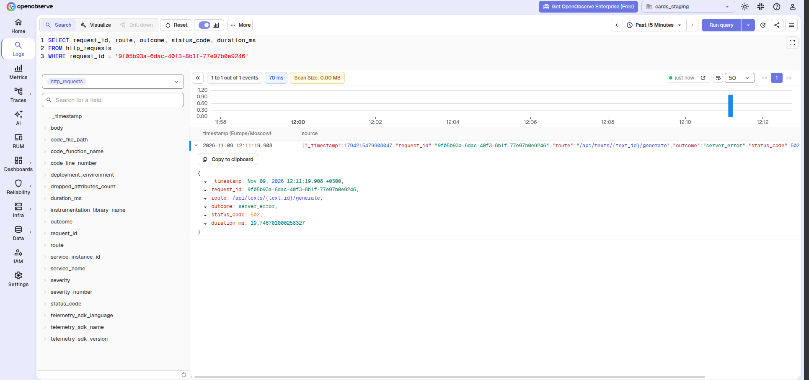
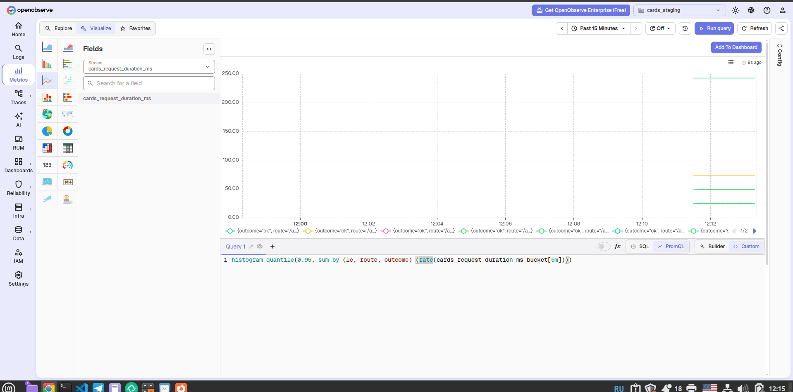
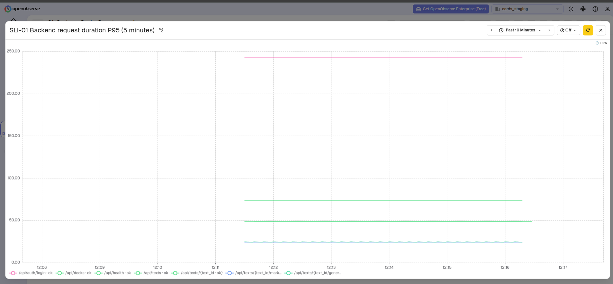
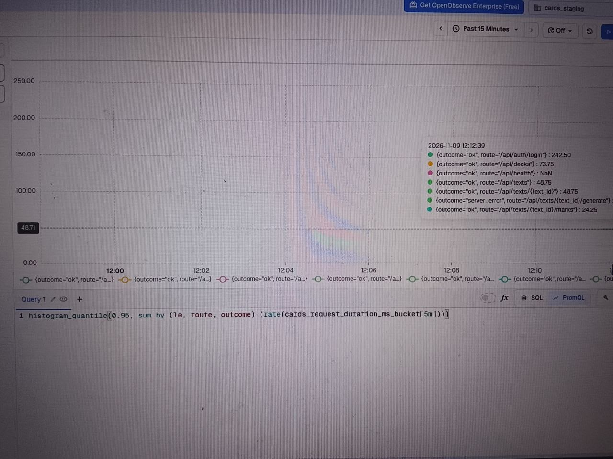
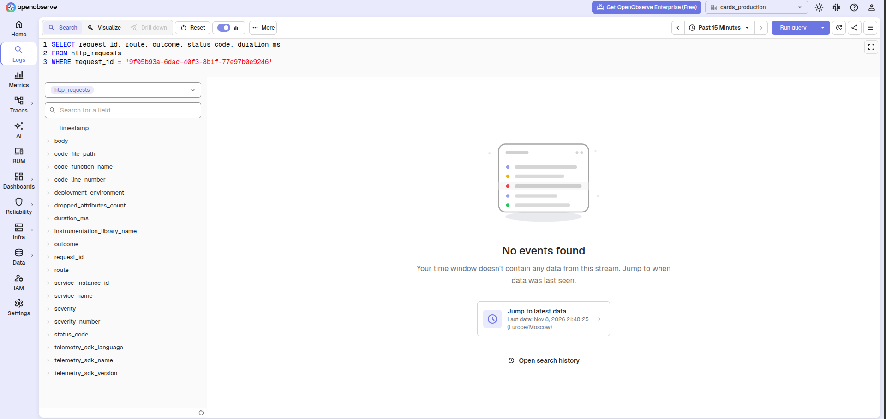

# QR-10 deployed staging check

On 2026-11-09, the team ran the core-task failure check against the staging deployment on the university VM. This is Week 7 follow-up: the earlier 2026-11-08 run found its log within 1.086 seconds but did not observe a numeric P95 within one minute, so it was not a Week 6 pass. No test request was sent to production.

## Timed result

| Field | Observed value |
| --- | --- |
| Environment | Staging |
| VM checkout commit reported for the deployment | `b6c354ff13712a5e75f348ef736a90b7ff5a4e75` |
| Response time | 2026-11-09 09:11:19.908929 UTC |
| Core-task route | `/api/texts/{text_id}/generate` |
| Response | HTTP 502, `x-request-id: 9f05b93a-6dac-40f3-8b1f-77e97b0e9246` |
| Matching log first queryable | 0.861 seconds after response |
| Log fields | `server_error`, status 502, duration 19.746701000258327 ms |
| SLI-01 failure P95 first numeric | 9.175 seconds after response |
| Numeric P95 | 24.704366594257436 ms |
| Checker's exit status | 0 |

The checker compared the route's failure histogram count with its pre-request baseline, then polled the exact [SLI-01 query](../../docs/observability.md#sli-01). Its [sanitized JSON output](qr10-result.json) reported `log_within_5_seconds: true` and `p95_within_60_seconds: true`. The terminal output supplied those elapsed times; screenshots alone cannot establish them. The VM checkout hash was recorded, but the running image was not independently labelled with its source commit in the supplied evidence.

## OpenObserve evidence

The [staging log query](images/qr10-staging-log.png) finds the response ID with the generation route, `server_error`, status 502, and a numeric `duration_ms`.

The [staging Metrics query](images/qr10-sli-query.png) shows the exact rolling five-minute SLI-01 PromQL. The [staging SLI-01 dashboard](images/qr10-sli-dashboard.png) plots the request-duration series. A [hover detail](images/qr10-sli-tooltip.png) identifies the generation route's `server_error` series; the timed checker gives its numeric P95.

The [production log search](images/qr10-production-no-match.png) for the same staging request ID found no event in the surrounding window. This checks the request ID's absence in production without sending production test traffic.

**Verdict:** QR-10 QRT-01 passes for the 2026-11-09 staging run at the reported checkout commit. The result is a Week 7 check and does not change the failed or incomplete Week 6 deadline result.
